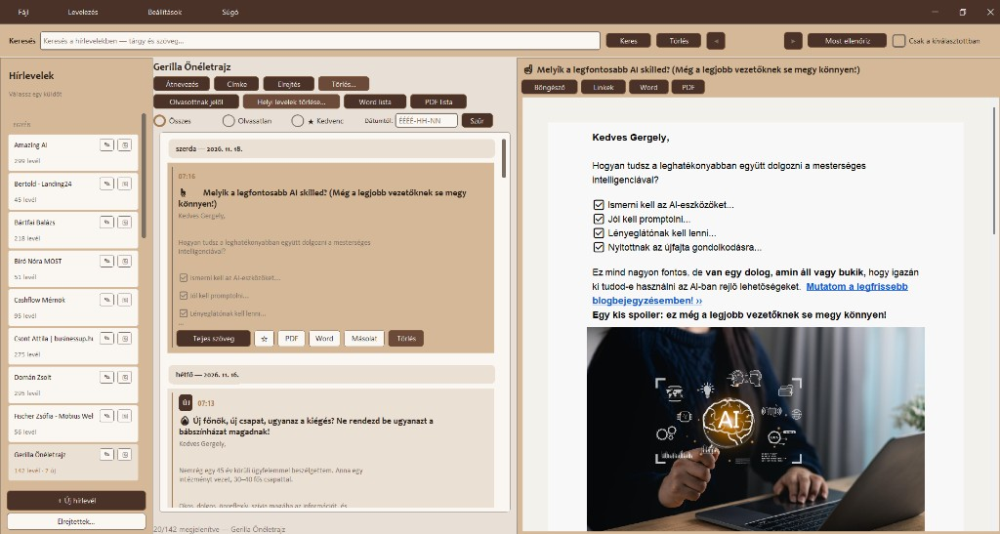

# Hírlevél követő

Helyi Windows program hírlevelek IMAP-ről történő archiválásához és olvasásához. A levelek és beállítások a gépeden maradnak (`%LOCALAPPDATA%\HirlevelKoveto`).

## Letöltés

**[GitHub Releases — legújabb win64 zip](https://github.com/Gergely-hub/hirlevel-archivalas/releases/latest)**

1. Töltsd le a `HirlevelKoveto-…-win64.zip` fájlt.
2. Csomagold ki bárhova (pl. `D:\Programok\HirlevelKoveto`).
3. Indítsd a **`HirlevelKoveto.exe`** fájlt.
4. Ha a Windows **ismeretlen kiadó** figyelmeztet: *További információ* → *Futtatás mégis* (nincs code signing).

Nincs telepítő — csak a Release zip számít hivatalos csomagnak (ne a „Code → Download ZIP” forráscsomagot add a végfelhasználóknak).

## Első lépések

- Részletes útmutató: [OLVASD.md](OLVASD.md)
- Fejlesztői build / release: [RELEASE.md](RELEASE.md)
- Hibajelzés: a programban **Súgó → Hibabejelentő…**, vagy [GitHub Issues](https://github.com/Gergely-hub/hirlevel-archivalas/issues)

## Röviden

| Téma | Megjegyzés |
|------|------------|
| Platform | Windows 64 bit |
| Levelezés | IMAP (Gmail, Outlook OAuth, Yahoo, iCloud, magyar szolgáltatók, egyéni) |
| ProtonMail | Kísérleti — csak **Proton Mail Bridge** (`127.0.0.1:1143`); nincs garancia |
| Outlook | *Bejelentkezés Microsoft-fiókkal* a fiók ablakban |
| Adatok | `%LOCALAPPDATA%\HirlevelKoveto` — a zip mappa mozgatható |

Licenc és jogi szövegek: a letöltött csomag `Hivatalos\` mappája, illetve a program **Súgó → Jogi Dokumentumok Központ…**.
